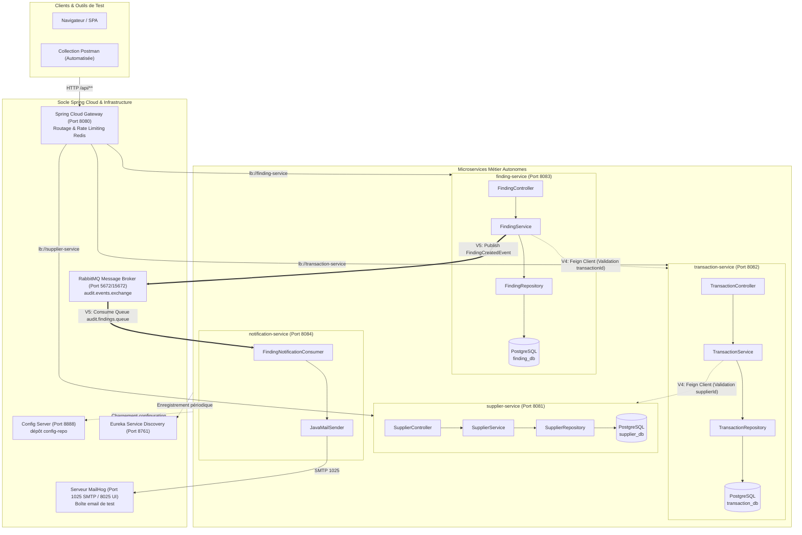
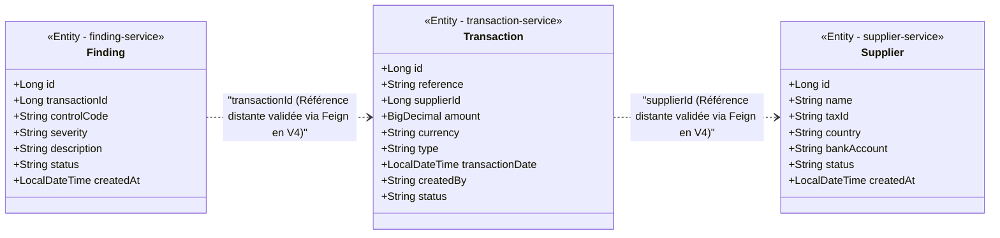
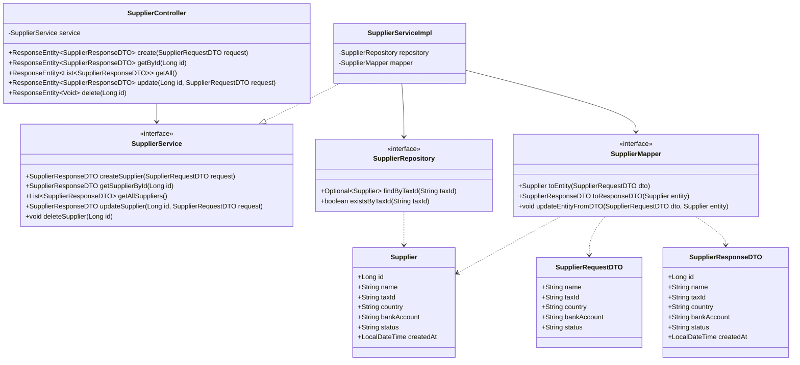
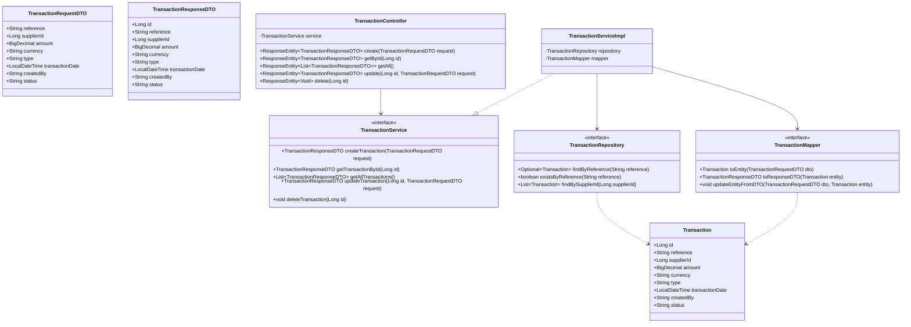
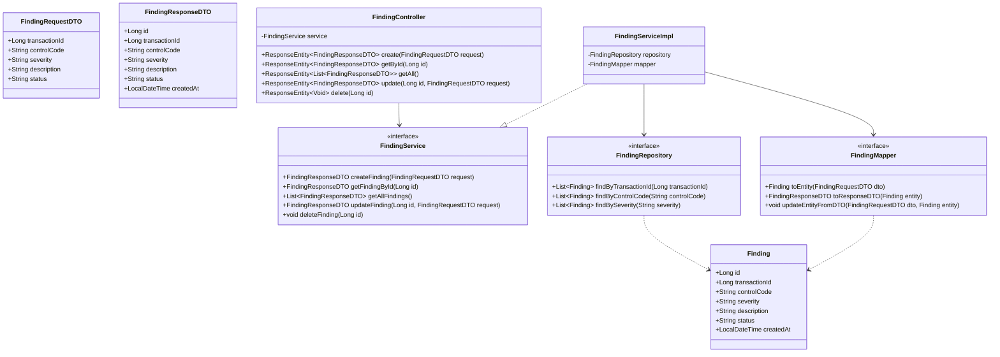

# Plateforme de Contrôle Continu et d'Analyse d'Audit

> **Projet académique — Architecture Microservices Java · Spring Boot 3 · Spring Cloud**  
> Conforme au cahier des charges officiel et à la grille d'évaluation du professeur.  
> **Jalons actuels implémentés : V0 (Conception), V1 (Métier & CRUD), V2 (Eureka), V3 (Gateway & Config), V4 (OpenFeign & Agrégation), V5 (RabbitMQ & Notifications) et V6 (Résilience & Idempotence) — 100% CONFORME À LA GRILLE (10/10 POINTS)**

---

## Sommaire

1. [Contexte et Objectifs du Projet](#1-contexte-et-objectifs-du-projet)
2. [Architecture Globale du Système (V0)](#2-architecture-globale-du-système-v0)
3. [Isolation des Données & Gestion des Références Distantes](#3-isolation-des-données--gestion-des-références-distantes)
4. [Diagrammes de Classes par Microservice](#4-diagrammes-de-classes-par-microservice)
5. [Structure Détaillée du Répertoire](#5-structure-détaillée-du-répertoire)
6. [Matrice des Ports & Composants](#6-matrice-des-ports--composants)
7. [Prérequis et Environnement](#7-prérequis-et-environnement)
8. [Instructions de Compilation et d'Exécution](#8-instructions-de-compilation-et-dexécution)
9. [Stratégie de Test & Collection Postman (V1)](#9-stratégie-de-test--collection-postman-v1)
10. [État d'Avancement et Feuille de Route (Jalons V0 à V6)](#10-état-davancement-et-feuille-de-route-jalons-v0-à-v6)

---

## 1. Contexte et Objectifs du Projet

La **Plateforme de Contrôle Continu et d'Analyse d'Audit** est un système distribué d'entreprise destiné à assister les directions d'audit interne et de contrôle de gestion dans la détection précoce d'anomalies financières, de fraudes et d'irrégularités réglementaires.

### Objectifs Métier
- **Gestion des Fournisseurs (`supplier-service`)** : référentiel centralisé des tiers certifiés avec contrôle d'unicité fiscale (`taxId`), validation bancaire et suivi du cycle de vie.
- **Gestion des Transactions (`transaction-service`)** : enregistrement et validation des flux financiers (factures, avoirs, paiements) rattachés aux fournisseurs.
- **Gestion des Constats d'Audit (`finding-service`)** : consignation des écarts, suspicions de doublons ou dépassements de seuil découverts lors des contrôles.
- **Notifications d'Alerte (`notification-service`)** : diffusion asynchrone des alertes d'audit aux auditeurs responsables via messagerie et SMTP de simulation (MailHog).

### Alignement Académique
Le projet est développé en conformité stricte avec la grille d'évaluation officielle :
- **Jalon V0** : Schéma d'architecture globale, diagrammes de classes avec références distantes explicites, documentation exhaustive.
- **Jalon V1** : Architecture en couches (`Entity-Repository-Service-Controller`), DTOs & Bean Validation, isolation stricte des bases de données (`Database per Service`), CRUD autonome et collection Postman automatisée.
- **Jalons V2 à V6 (Planifiés)** : Découverte de services (Eureka), API Gateway & routage dynamique, Config Server externalisé, OpenFeign & DTOs agrégés, Broker RabbitMQ, Résilience Resilience4j & Idempotence.

---

## 2. Architecture Globale du Système (V0)

Le système repose sur le paradigme des microservices Spring Cloud. Chaque service métier est autonome, stateless au niveau applicatif et propriétaire exclusif de son magasin de données.



---

## 3. Isolation des Données & Gestion des Références Distantes

### Règle d'Or : Database per Service
Chaque microservice métier manipule **exclusivement** sa propre base de données PostgreSQL :
- `supplier_db` est la propriété exclusive de `supplier-service`.
- `transaction_db` est la propriété exclusive de `transaction-service`.
- `finding_db` est la propriété exclusive de `finding-service`.

**Interdictions strictes :**
1. Aucune clé étrangère physique SQL inter-bases (`FOREIGN KEY` interdite entre bases distinctes).
2. Aucun mapping d'association JPA cross-service (`@ManyToOne`, `@OneToMany` interdits entre entités de services distincts).
3. Aucune requête SQL croisée (`JOIN` direct impossible entre bases distinctes).

### Modélisation des Références Distantes
Les liaisons entre entités distribuées s'effectuent par **identifiants scalaires simples** :



- **`Transaction.supplierId`** : Contient l'identifiant du fournisseur. En phase V1, le champ est validé syntaxiquement (`@NotNull`, `@Positive`). En phase V4, la présence du tiers est validée auprès de `supplier-service` avant toute persistance.
- **`Finding.transactionId`** : Contient l'identifiant de la transaction auditée. En phase V1, le champ est validé syntaxiquement. En phase V4, l'existence de la transaction est vérifiée via OpenFeign auprès de `transaction-service`.

---

## 4. Diagrammes de Classes par Microservice

Chaque microservice respecte scrupuleusement l'architecture en couches :
`Controller` $\rightarrow$ `Service` $\rightarrow$ `Repository` $\rightarrow$ `Database`, avec découplage strict par `DTO` et `MapStruct`.

### 4.1. supplier-service



### 4.2. transaction-service



### 4.3. finding-service



---

## 5. Structure Détaillée du Répertoire

```text
pfa-5/
├── pom.xml                                  # POM Parent multi-modules (Java 21, Spring Boot 3.3.5)
├── docker-compose.yml                       # Infrastructure locale (PostgreSQL, RabbitMQ, Redis, MailHog)
├── README.md                                # Documentation exhaustive d'architecture et de référence
├── docker/
│   └── init-databases.sql                   # Initialisation des 3 bases : supplier_db, transaction_db, finding_db
├── config-repo/                             # Dépôt de configuration externalisé (Config Server - V3)
│   ├── application.yml                      # Configuration globale partagée
│   ├── api-gateway.yml                      # Routes de l'API Gateway et rate limiting
│   ├── supplier-service.yml                 # Paramètres de supplier-service
│   ├── transaction-service.yml              # Paramètres de transaction-service + Resilience4j
│   ├── finding-service.yml                  # Paramètres de finding-service + AMQP + Resilience4j
│   └── notification-service.yml             # Paramètres de notification-service + MailHog
├── docs/                                    # Documents officiels et diagrammes
│   ├── Cahier_des_charges_microservices_adapte_grille_professeur.pdf
│   ├── Cahier_des_charges_Plateforme_Controle_Continu.pdf
│   ├── Grille_evaluation_projet.pdf
│   ├── diagramme_cas_utilisation_phase1_audit.png
│   └── diagramme_classes_uml_phase1_audit.png
├── postman/                                 # Livrable Postman V1 (assertions automatisées)
│   ├── Audit_Platform_V1.postman_collection.json
│   └── Audit_Platform_Local.postman_environment.json
│
├── config-server/                           # Module Spring Cloud Config Server (Port 8888 - V3)
├── eureka-server/                           # Module Spring Cloud Netflix Eureka (Port 8761 - V2)
├── api-gateway/                             # Module Spring Cloud Gateway (Port 8080 - V3/V6)
├── notification-service/                    # Module Spring AMQP & Mail (Port 8084 - V5)
│
├── supplier-service/                        # Microservice Fournisseurs (Port 8081 - V1)
│   ├── pom.xml
│   └── src/
│       ├── main/java/com/audit/platform/supplier/
│       │   ├── SupplierServiceApplication.java
│       │   ├── controller/SupplierController.java
│       │   ├── dto/request/SupplierRequestDTO.java
│       │   ├── dto/response/SupplierResponseDTO.java
│       │   ├── entity/Supplier.java
│       │   ├── exception/GlobalExceptionHandler.java
│       │   ├── exception/ResourceNotFoundException.java
│       │   ├── exception/DuplicateResourceException.java
│       │   ├── exception/ErrorResponse.java
│       │   ├── mapper/SupplierMapper.java
│       │   ├── repository/SupplierRepository.java
│       │   └── service/SupplierService.java & impl/SupplierServiceImpl.java
│       ├── main/resources/application.yml
│       └── test/java/com/audit/platform/supplier/
│           ├── SupplierServiceTest.java
│           └── SupplierControllerIntegrationTest.java
│
├── transaction-service/                     # Microservice Transactions (Port 8082 - V1)
│   ├── pom.xml
│   └── src/
│       ├── main/java/com/audit/platform/transaction/
│       │   ├── TransactionServiceApplication.java
│       │   ├── controller/TransactionController.java
│       │   ├── dto/request/TransactionRequestDTO.java
│       │   ├── dto/response/TransactionResponseDTO.java
│       │   ├── entity/Transaction.java
│       │   ├── exception/...
│       │   ├── mapper/TransactionMapper.java
│       │   ├── repository/TransactionRepository.java
│       │   └── service/TransactionService.java & impl/TransactionServiceImpl.java
│       ├── main/resources/application.yml
│       └── test/java/com/audit/platform/transaction/
│           ├── TransactionServiceTest.java
│           └── TransactionControllerIntegrationTest.java
│
└── finding-service/                         # Microservice Constats d'Audit (Port 8083 - V1)
    ├── pom.xml
    └── src/
        ├── main/java/com/audit/platform/finding/
        │   ├── FindingServiceApplication.java
        │   ├── controller/FindingController.java
        │   ├── dto/request/FindingRequestDTO.java
        │   ├── dto/response/FindingResponseDTO.java
        │   ├── entity/Finding.java
        │   ├── exception/...
        │   ├── mapper/FindingMapper.java
        │   ├── repository/FindingRepository.java
        │   └── service/FindingService.java & impl/FindingServiceImpl.java
        ├── main/resources/application.yml
        └── test/java/com/audit/platform/finding/
            ├── FindingServiceTest.java
            └── FindingControllerIntegrationTest.java
```

---

## 6. Matrice des Ports & Composants

| Composant | Port | Type | Responsabilité Métier / Rôle |
|---|---|---|---|
| **Config Server** | `8888` | HTTP | Distribution externalisée des configurations Spring Cloud |
| **Eureka Server** | `8761` | HTTP / UI | Annuaire dynamique et enregistrement des instances de services |
| **API Gateway** | `8080` | HTTP | Point d'entrée unique, filtrage, routage et limitation de débit |
| **Supplier Service** | `8081` | REST | Référentiel des tiers fournisseurs (`supplier_db`) |
| **Transaction Service** | `8082` | REST | Gestion des transactions financières auditées (`transaction_db`) |
| **Finding Service** | `8083` | REST | Détection et gestion des constats d'audit (`finding_db`) |
| **Notification Service** | `8084` | Worker | Consommateur d'événements AMQP et expéditeur des emails |
| **PostgreSQL** | `5432` | SGBD | 3 bases de données logiques autonomes et isolées |
| **RabbitMQ** | `5672` | AMQP | Broker de messages asynchrone (AMQP 0-9-1) |
| **RabbitMQ Management**| `15672` | HTTP / UI | Console d'administration et surveillance des files |
| **Redis** | `6379` | Cache/K-V | Stockage en mémoire pour le Rate Limiting réactif de l'API Gateway |
| **MailHog SMTP** | `1025` | SMTP | Réception des emails émis par le service de notification |
| **MailHog UI** | `8025` | HTTP / UI | Interface Web de consultation des emails capturés pour démo |

---

## 7. Prérequis et Environnement

- **Système d'exploitation** : Windows 11 / Linux / macOS.
- **Java Development Kit** : Eclipse Temurin JDK 21 (LTS).
- **Gestionnaire de dépendances** : Apache Maven 3.9+.
- **SGBD / Conteneurisation** :
  - Option A (Recommandée pour exécution complète) : Docker Desktop (PostgreSQL, RabbitMQ, MailHog).
  - Option B (Développement & Tests automatisés) : Profil H2 en mémoire embarqué (`--spring.profiles.active=test`).

---

## 8. Instructions de Compilation et d'Exécution

### 8.1. Compilation globale du projet
Depuis la racine du projet `pfa-5` :
```powershell
mvn clean compile
```

### 8.2. Exécution des tests automatisés
Pour lancer l'ensemble des tests unitaires et d'intégration (avec base H2 en mémoire isolée) :
```powershell
mvn test
```

Pour lancer les tests d'un service spécifique :
```powershell
mvn test -pl supplier-service
mvn test -pl transaction-service
mvn test -pl finding-service
```

### 8.3. Démarrage de l'infrastructure Docker (Optionnel en V1)
Si Docker Desktop est démarré :
```powershell
docker compose up -d postgres
```
Les bases `supplier_db`, `transaction_db` et `finding_db` seront créées automatiquement selon le script `docker/init-databases.sql`.

### 8.4. Lancement individuel des microservices (Jalon V1)

Chaque service peut être lancé individuellement via Maven :

**Lancement de supplier-service (Port 8081) :**
```powershell
mvn spring-boot:run -pl supplier-service
```

**Lancement de transaction-service (Port 8082) :**
```powershell
mvn spring-boot:run -pl transaction-service
```

**Lancement de finding-service (Port 8083) :**
```powershell
mvn spring-boot:run -pl finding-service
```

*Remarque :* Par défaut, si PostgreSQL local n'est pas actif, vous pouvez activer le profil `test` ou `h2` pour faire tourner le service sur une base en mémoire H2 :
```powershell
mvn spring-boot:run -pl supplier-service -Dspring-boot.run.profiles=test
```

---

## 9. Stratégie de Test & Collection Postman (V1)

Le livrable V1 s'appuie sur une collection Postman versionnée sous `postman/Audit_Platform_V1.postman_collection.json`.

### Endpoints CRUD exposés :

#### 1. Supplier Service (`http://localhost:8081/api/suppliers` ou `/suppliers`)
- `POST /api/suppliers` : Création d'un fournisseur avec validation stricte (nom, taxId unique, pays, compte bancaire). Code retour : `201 Created`.
- `GET /api/suppliers` : Liste exhaustive des fournisseurs. Code retour : `200 OK`.
- `GET /api/suppliers/{id}` : Consultation par identifiant. Code retour : `200 OK` ou `404 Not Found`.
- `PUT /api/suppliers/{id}` : Mise à jour des coordonnées et statut. Code retour : `200 OK` ou `404 Not Found`.
- `DELETE /api/suppliers/{id}` : Suppression d'un fournisseur. Code retour : `204 No Content` ou `404 Not Found`.

#### 2. Transaction Service (`http://localhost:8082/api/transactions` ou `/transactions`)
- `POST /api/transactions` : Enregistrement d'une transaction avec référence unique, montant positif et devise valide. Code retour : `201 Created`.
- `GET /api/transactions` : Liste de toutes les transactions. Code retour : `200 OK`.
- `GET /api/transactions/{id}` : Détails d'une transaction. Code retour : `200 OK` ou `404 Not Found`.
- `PUT /api/transactions/{id}` : Mise à jour d'une transaction. Code retour : `200 OK` ou `404 Not Found`.
- `DELETE /api/transactions/{id}` : Suppression d'une transaction. Code retour : `204 No Content` ou `404 Not Found`.

#### 3. Finding Service (`http://localhost:8083/api/findings` ou `/findings`)
- `POST /api/findings` : Déclaration d'un constat d'audit (code contrôle, sévérité, description). Code retour : `201 Created`.
- `GET /api/findings` : Liste de tous les constats d'audit. Code retour : `200 OK`.
- `GET /api/findings/{id}` : Consultation d'un constat. Code retour : `200 OK` ou `404 Not Found`.
- `PUT /api/findings/{id}` : Mise à jour de la sévérité ou du statut. Code retour : `200 OK` ou `404 Not Found`.
- `DELETE /api/findings/{id}` : Clôture/Suppression d'un constat. Code retour : `204 No Content` ou `404 Not Found`.

### Assertions Postman Automatisées
Chaque requête de la collection intègre des tests JavaScript exécutés à la volée :
1. Vérification du code de statut HTTP attendu (`201`, `200`, `204`, `400`, `404`, `409`).
2. Extraction et stockage dynamique des identifiants créés dans des variables d'environnement (`supplierId`, `transactionId`, `findingId`).
3. Validation de la conformité du payload JSON (présence des champs obligatoires, égalité des valeurs transmises).
4. Validation des messages d'erreur standardisés du `GlobalExceptionHandler` (`timestamp`, `status`, `error`, `message`, `path`).

---

## 10. État d'Avancement et Feuille de Route (Jalons V0 à V6)

| Jalon | Intitulé | Statut | Détail de Réalisation |
|:---:|---|:---:|---|
| **V0** | **Conception & Documentation** | **RÉALISÉ** | Architecture globale documentée, diagrammes de classes avec références distantes, fichier README exhaustif. |
| **V1** | **Implémentation Métier & CRUD** | **RÉALISÉ** | Architecture 4 couches respectée, DTOs & MapStruct, Bean Validation, 3 bases isolées, 58 tests JUnit 5/Mockito, collection Postman. |
| **V2** | **Service Discovery (Eureka)** | **RÉALISÉ** | Enregistrement dynamique et autonome des microservices sur Eureka Server (Port 8761) avec statuts UP validés en runtime. |
| **V3** | **API Gateway & Config Server** | **RÉALISÉ** | Config Server centralisé (Port 8888, profil native) et API Gateway dynamique avec Load Balancing Eureka (Port 8080). |
| **V4** | **Communication Synchrone (OpenFeign)** | **RÉALISÉ** | Clients OpenFeign typés (`SupplierClient`, `TransactionClient`), validation préalable des clés distantes et endpoints de consultation enrichie `/details`. |
| **V5** | **Communication Asynchrone (RabbitMQ)** | **RÉALISÉ** | Publication de `FindingCreatedEvent` sur RabbitMQ, consommation par `notification-service` (Port 8084) et expédition email (MailHog). |
| **V6** | **Résilience, Erreurs & Idempotence** | **RÉALISÉ** | Intégration de Resilience4j (Circuit Breaker & Retry avec fallback) sur appels Feign, gestion centralisée des erreurs (`ControllerAdvice`) et idempotence des créations. |

### Perspective Long-Terme (Phase 2 & IA)
Une fois le socle académique V0 à V6 validé :
- Intégration d'un microservice d'audit analytique sous **Python FastAPI**.
- Modélisation de détection d'anomalies (loi de Benford, forêts d'isolement).
- Agent RAG d'investigation d'audit pour interroger la base documentaire et les constats d'audit.

